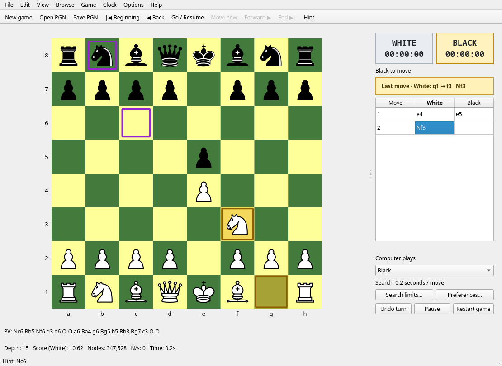

# Arasan Paradox

A native Linux chess GUI powered by the [Arasan chess engine](https://arasanchess.org/), built with Python and Qt.

Arasan Paradox recreates the familiar desktop controls of Arasan's Windows interface and adds a simple improvement: **the last move stays marked on both its starting and ending squares**, so you can look away and still see what happened.



### Features at a glance

- Persistent last-move highlights and a readable “from → to” label.
- Fixed-depth, fixed-time, combined time/depth, incremental and tournament search controls.
- Computer White, Black, both sides, or manual play.
- Reversible move navigation, undo, restart, pause and move-now controls.
- Hints, continuous analysis, principal variation and live engine statistics.
- PGN collections, comments and variations; FEN/PGN clipboard support.
- Automatic recovery, completed-game archives and configurable engine settings.
- Multiple piece sets, customizable board colors and board rotation.

This is an independent project, not an official Arasan release.

## Launch

Requires Linux, Python 3.10 or newer, Qt runtime libraries, and an Arasan engine executable. Download Arasan from the [official downloads page](https://arasanchess.org/downld.shtml), choosing a binary compatible with your CPU. Keep its neural network and opening book beside the executable.

Clone and install:

```sh
git clone https://github.com/Danielxpj/ArasanParadox.git
cd ArasanParadox
python3 -m venv .venv
.venv/bin/python -m pip install -r requirements.txt
ARASAN_ENGINE=/absolute/path/to/arasanx-64-avx2-bmi2 ./run.sh
```

Use the actual name of your downloaded engine in that command. Alternatively, place an `arasan` executable or wrapper on `PATH`; the app also checks `~/.local/bin/arasan`. The engine is installed separately and is not bundled here.

If your distribution already provides PySide6, you can create the environment with `python3 -m venv --system-site-packages .venv` to reuse it. The app was tested on CachyOS with Python 3.14 and Arasan 26.1.

## Controls

- Click a piece and destination to move. Legal destinations are dotted. Pawn promotion offers Queen, Rook, Bishop or Knight. Castling and en passant follow normal chess rules.
- **Computer plays:** White, Black, Both (self-play), or Neither (manual play). This changes immediately. Selecting White rotates the board automatically.
- **Options → Search Limits:** fixed seconds per move, fixed depth in plies, combined time/depth (whichever is reached first), increment clocks, or repeating tournament periods. A time limit is a search budget; the engine can finish early for a book or forced move.
- **Go / Ctrl+G:** ask Arasan to play the current side. **Pause / Space:** pause or resume normal human/computer play. **Move now / Escape:** interrupt the search and use its best move; during analysis, stop without moving.
- **Back / Ctrl+T, Forward / Ctrl+F, Beginning / Home, End / End:** browse moves without erasing the continuation. Click a move in the table to jump there. Browsing pauses clocks and engine play.
- **Undo turn / Ctrl+Z:** rewind to the previous human turn. Press Space to resume, then play a different move. Old continuations are retained as PGN variations.
- **Restart:** return to the game's initial position, including a custom FEN setup. **New / Ctrl+N:** start a standard game.
- **Hint / Ctrl+H:** mark a suggested move in purple without playing it. **Analyze / Ctrl+A:** analyze the current position until stopped. Gold last-move marks remain visible independently.
- **Rotate / Ctrl+R:** change board orientation.
- **File:** open/save multi-game PGN, recent files, Save As. Comments and variations are preserved. Browse selects games in a PGN collection.
- **Edit:** copy FEN or PGN; paste FEN or PGN. **Game:** resign or claim an eligible repetition/fifty-move draw.
- **View:** toggle toolbar, move panel, principal variation, status bar.

## Search and appearance preferences

Set CPU threads, hash memory (manual or automatic), Elo strength limitation, opening-book use/variety, position learning, Syzygy directory, move/error sounds, background analysis, optional automatic resignation and completed-game archive pathname.

Appearance supports Classic, Celtic and Spatial pieces plus letters; adjustable board size, coordinates and legal-move markers. Board and highlight colors are configurable. The current position's last move is permanently outlined and described in text until another move or navigation changes it.

Both clocks show elapsed time in fixed-time/depth modes, or remaining time in incremental/tournament modes. Changing search limits resets clocks. Browsing restores recorded clock snapshots where available; PGN files without clock data start from the configured clock values.

Automatic recovery is at `$XDG_STATE_HOME/arasan-paradox` (normally `~/.local/state/arasan-paradox`). Startup restores the last game paused. Completed games are appended to the configured archive. GUI preferences use Qt's user settings directory.

## Reference and parity notes

The menu hierarchy and search modes were verified against the original Windows source, rather than inferred solely from screenshots:

- [Arasan Windows menu/dialog definitions](https://github.com/jdart1/arasan-chess/blob/5d6be86cb74dd51df2b29f7f9e6bcbe95fb1765d/gui/gui.rc), local copy `references/upstream-gui.rc`.
- [Arasan 23.3 screenshot](https://img.informer.com/screenshots/8101/8101404_1.png).
- [Additional historical screenshots](https://www.mobygames.com/game/67761/arasan-chess/screenshots/).
- [Official engine documentation](https://github.com/jdart1/arasan-chess).

This is an independent Qt implementation, not a binary port or pixel-identical Windows clone. Mainline navigation is visible in the move table; imported PGN side variations are preserved on export, but there is no variation-tree editor. “Think when idle” provides background analysis; it does not reuse the original GUI's predicted-reply pondering state. Automatic resignation uses an explicit local threshold (below −9 pawns for three engine moves). The engine process is restarted for each search, so its hash table is not retained across searches. Auto hash allocates up to 1/16 of physical memory, capped at 2 GiB. These differences are intentional and visible in the implementation.

## Verification

```sh
QT_QPA_PLATFORM=offscreen .venv/bin/python -m unittest -v test_app
```

Tests cover real Arasan depth/time searches, hints, search interruption, stale result rejection, side switching, board clicks, persistent move markings, increment/tournament clocks, time forfeits, recovery, PGN collections and variations, special moves, and all piece-set renders. Tests isolate user settings and recovery files.

## Files and credits

- `main.py`: interface, controls, clocks, persistence.
- `engine.py`: cancellable UCI searches off the GUI thread.
- `model.py`: reversible game timeline and PGN variations.
- `test_app.py`: regression/integration tests.
- `assets/pieces`: Celtic and Spatial sets by Maurizio Monge, distributed with Arasan; individual MIT license files are included.
- `references`: original menu resource and its license.

Arasan engine by Jon Dart. PySide6 and python-chess retain their respective licenses; the classic SVG rendering is supplied by python-chess. The original menu resource's license is in `references/ARASAN-LICENSE`. Screenshots are reference material, not application assets.

## License

Arasan Paradox application code is licensed under **GPL-3.0-or-later**; see [LICENSE](LICENSE). Third-party assets retain their own licenses. The Arasan engine and bundled reference resource are MIT-licensed; Celtic and Spatial piece sets include their MIT notices. python-chess is GPL-3.0-or-later, and PySide6 is provided under its upstream licensing terms.
